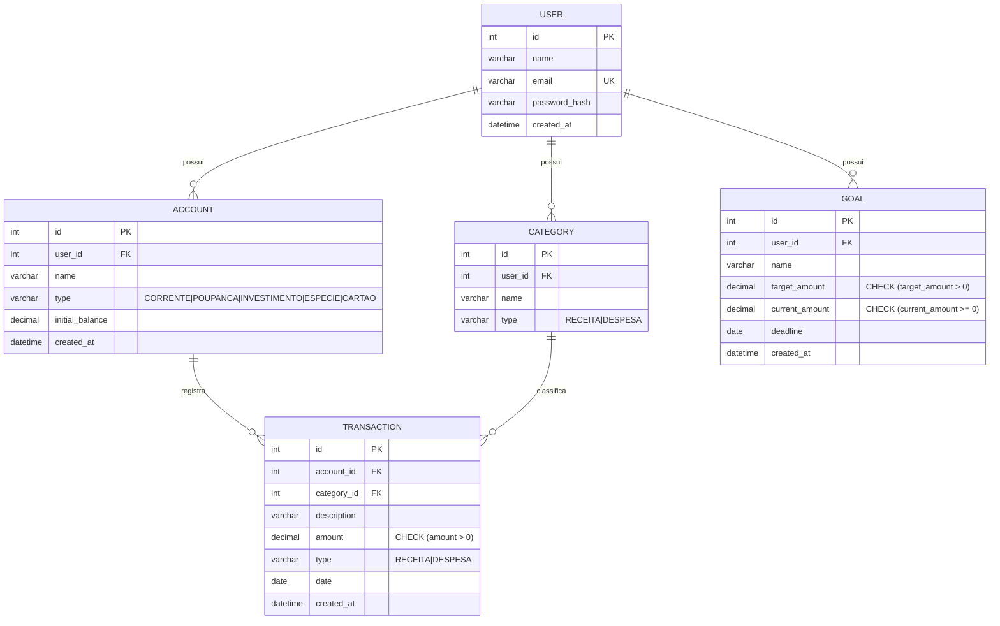

# DER — Diagrama Entidade-Relacionamento (5 Centavos)

## Entidades e relacionamentos

## Observações

* Não há coluna `user_id` em `transactions`: o isolamento do usuário é garantido
  via `account_id → accounts.user_id` (3FN — sem redundância).
* Exclusão de usuário remove suas contas, categorias e metas (`ON DELETE CASCADE`);
  transações são removidas junto da conta. Categorias em uso são protegidas por
  `ON DELETE RESTRICT` — não é possível apagar categoria com transações.
* Categorias possuem `UNIQUE (user_id, name, type)` — impedindo duplicidades.
* Saldos não são persistidos: `saldo = initial_balance + receitas − despesas`,
  calculado sob consulta (consistência garantida com qualquer edição).
